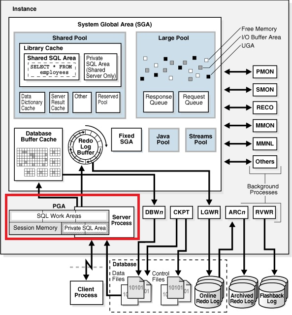
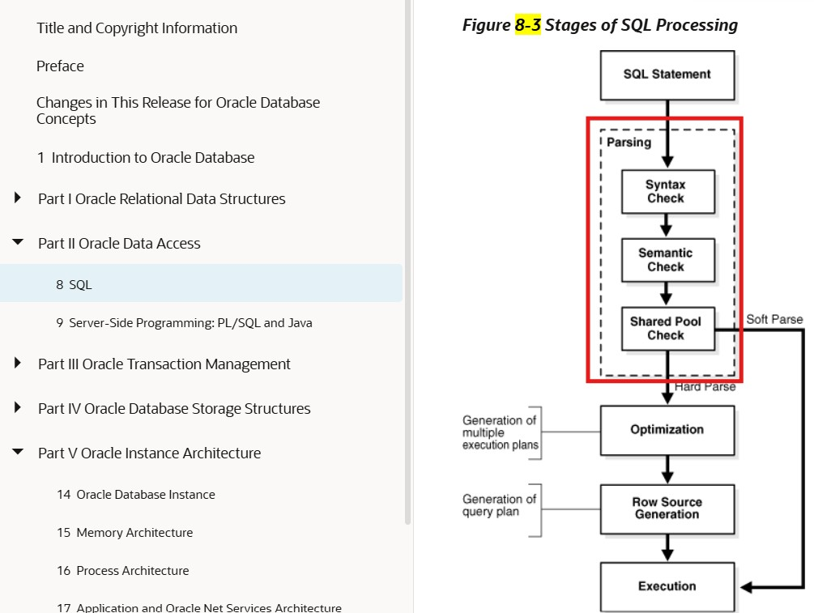
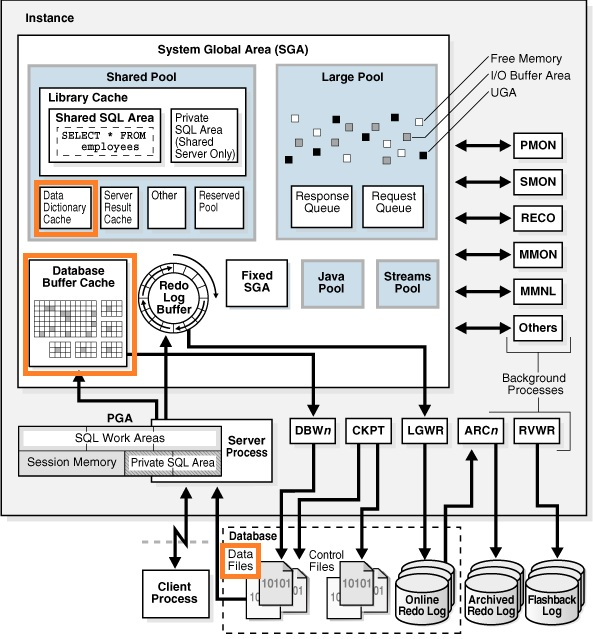
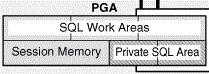

## 261012mon
### 실행 계획 <a id="sql-plan"></a>
- Data 처리 방법 결정
  - rowid Scan 방식 ( Single Block I/O 발생 ) == Block I/O 1회 발생
    - by user rowid 방식
      - ```SQL
        SELECT rowid, e.* FROM HR.EMPLOYEES e;
        ```
        |ROWID|EMPLOYEE_ID|. . .|
        |:---|---:|---|
        AAAWbQAAKAAAADOAAA|100|. . .|
        AAAWbQAAKAAAADOAAB|101|. . .|
        AAAWbQAAKAAAADOABA|164|. . .|
        AAAWbQAAKAAAADOABB|165|. . .|
        AAAWbQAAKAAAADPAAA|198|. . .|
        AAAWbQAAKAAAADPAAB|199|. . .|
        . . .|. . .|. . .|
        - ROWID == 6 + 3 + 6 + 3 자리로 구성
          - 첫 6자리 == ' SELECT * FROM dba_objects WHERE object_name = 'EMPLOYEES'; ' 실행하여 확인되는 ' DATA_OBJECT_ID ' ( Object 고유 Number )
          - 이후 3자리 == ' SELECT * FROM dba_data_files WHERE tablespace_name = 'SYSAUX'; ' 실행하여 확인되는, ' FILE_ID '
          - 이후 6자리 == ' SELECT * FROM dba_extents WHERE segment_name = 'EMPLOYEES'; ' 실행하여 확인되는, ' BLOCK_ID '
          - 마지막 3자리 == Block 內 Row Slot Number ( 위치 )
      - 유저가 직접 rowid 수행하는 방식
      - Data 찾는 방법 中 가장 빠른 방식
        - ```SQL
          --SELECT * FROM HR.EMPLOYEES WHERE employee_id = 100;
          SELECT * FROM HR.EMPLOYEES WHERE rowid = 'AAAWbQAAKAAAADOAAA';
          ```
    - by index rowid 방식
  - Full Table Scan 방식 ( Multi Block I/O 발생 ) == 처음부터 마지막 Block 스캔하며, 탐색 ( 값을 찾아도 중간에 종료되지 않고, 마지막 블록까지 Access Scan )
- Join 방법
- Join 순서
---
</br></br></br>


### 서버 프로세스 (Server Process) == SQL 처리기  <a id="server-process"></a>


- 서버 프로세스 (Server Process) 內 PGA(Program Global Area) Memory 內 UGA Memory 생성
- [UGA](#uga) 內 Private SQL Area 영역에서 SQL 문장 처리
</br></br></br>
#### Private SQL Area == Cursor == SQL 실행 영역에서, SELECT, DML 처리 단계 (1/4) == Parse


> https://docs.oracle.com/en/database/oracle/oracle-database/19/cncpt/sql.html#GUID-1B95E60C-99C5-446D-9C6B-5D16EFE59ACF:~:text=the%20general%20stages%3A-,Figure%208%2D3%20Stages%20of%20SQL%20Processing,-Description%20of%20%22Figure
1. User Process, SQL 문장을 던진다
2. Server Process, CURSOR Memory 할당받고
3. User Process 던져준 SQL 문장을 받아서, 이미지상의 ' Parsing ' 작업
- Syntax Check ( 문법 체크 ) == ' SELECT ', ' FROM ', ' WHERE ', ' * ', ' = ' 등의 문법을 옳게 작성했는지 Check
- Semantic Check ( 의미 분석 체크 ) == ' Data Dictionary ' 정보로, 테이블의 소유자명, Object Type, SQL 문장 실행 권한 등을 Check
  - 

    - ' Data Dictionary ' 정보는 ' Data Files ' 內 존재
      - 이를 Semantic Check (의미 분석 체크 ) 할때마다, 디스크의 ' Data Files ' I/O 부담으로, [Database Buffer Cache](SGA.md#database-buffer-cache) 메모리에 Block 단위로 올려두고, 더욱 빠른 사용을 위해서 [Shared Pool 內 Data dictionary Cache](SGA.md#data-dictionary-cache) 공간에 ROW 단위로 올려두고 사용한다
        - 하여, Semantic Check ( 의미 분석 체크 ) 시도시, ' Data Dictionary Cache ' > ' Database Buffer Cache ' > 디스크 순으로 탐색한다 ( 디스크에서 발견시, 역순으로 캐시에 올린 後 Check )
  - ```SQL
    SELECT *
    FROM sys.user$ /* Oracle 내부 Data Dictionary Table ( 직접 INSERT / UPDATE / DELETE / 구조 변경은 하지 않는 것이 원칙 ) */
    WHERE USERNAME = 'HR';


    SELECT *
    FROM sys.obj$ /* 실제 Data 저장된 테이블로서, 일반 유저는 조회 불가 ( 테이블, 인덱스, 뷰, 프로시저 등 모든 객체의 기본 메타 정보가 마스터격 )*/
    WHERE OWNER = 'HR' AND OBJECT_NAME = 'EMPLOYEES';


    SELECT *
    FROM sys.tab$; /* Object 타입이 테이블일 경우, 테이블의 실제 정보가 저장된 Table 통계 정보 조회 ( 테이블의 고유 특성(저장 공간 설정 등) )*/


    SELECT *
    FROM sys.seg$; /* 어느 ' 테이블 스페이스 ', 어느 Data 파일에 저장되어 있는지 조회 */


    SELECT *
    FROM sys.col$; /* 테이블에 속한 컬럼들의, Meta 및 통계 정보가(Data Type, 길이 등) 저장된 원본 Dictionary Table */


    SELECT *
    FROM sys.objauth$; /* Object 권한에 대한 정보 조회 */
    ```
    > 내부적으로 ' Data Dictionary ' 정보를 이용하여 Semantic Check ( 의미 분석 체크 )
- Soft Parsing
  - 동일한 SQL 문장이 Shared Pool 메모리 內 [Library Cache](SGA.md#library-cache) 영역에 있는지 조회하여, 있다면 [실행 계획](#sql-plan) 공유 ( 재활용 )
    - |동일한 SQL 조건|
      |---|
      |대, 소문자와 공백, TAB, ENTER KEY|
      |소유자 名.TABLE (VIEW) 객체 名|
      |힌트 ( /\*+ \*/), 주석 (--, /* */)|
      |상수값, 리터럴 값 일치|
- Hard Parsing
  - 동일한 SQL 문장이 없다면, 새로 Memory 할당받아서 Optimizer 프로그램이 Dictionary TABLE 內 Table, Column 통계 정보로 ' 실행 계획 ' 생성
</br></br></br>
####  SELECT, DML 처리 단계 (2/4) == Bind
- SQL 문장에, 상수가 아닌 변수 처리가 되어있는 경우 == 실제값이 입력되는 단계
  - 변수 처리가 없는 경우, 생략되는 단계
</br></br></br>
####  SELECT 처리 단계 (3/4) == Execute
- [실행 계획](#sql-plan) 사용해서, Block I/O 발생 ( [Database Buffer Cache](SGA.md#database-buffer-cache) Access )
- Active Set 결과 생성
</br></br></br>
####  DML 처리 단계 (3/4) == Execute
- ROLLBACK 위한, UNDO 발생
- [실행 계획](#sql-plan) 사용해서, Transaction 대상 Block I/O 발생 ( [Database Buffer Cache](SGA.md#database-buffer-cache) Access )
- Redo Log Buffer 內 Redo Entry 생성
- 이전 값은 UNDO 블록에 작성하고, 새값으로 변경 ( 변경된 블록은 Dirty Buffer 상태가 된다 )
</br></br></br>
####  SELECT 처리 단계 (4/4) == Fetch
- Active Set 결과를, User 프로세스로 전달
---
</br></br></br>


### PGA(Program Global Area) <a id="pga"></a>
- Server Process, Background 프로세스의 Data 및 제어 정보를 포함하는 전용 ( Private ) Memory 영역
- Stack Space ( 변수 )
- UGA(User Global Area) <a id="uga"></a>
  - 

    - Private SQL Area == 커서에 대한, 런타임 정보를 저장하기 위한 Cursor 영역 ( SQL 실행 영역 )
    - Session Memory == 세션을 제어하기 위한 정보 ( 유저 Session Data 저장 영역 )
    - SQL Work Area == SQL 작업 영역 ( 8i Version 까지는 수동 관리 필수 )
      - ```SQL
        SELECT *
        FROM v$parameter
        WHERE NAME IN ('workarea_size_policy', 'pga_aggregate_target');
        ```
        > ' workarea_siz_policy ' 파라미터의 ' DISPLAY_VALUE ' == ' AUTO ' == ' workarea_size_policy ' 값을 기준으로 자동 관리하겠다는 의미 ( 9i Version 신기능 )
        - sort_area_size
        - hash_area_size
        - bitmap_merge_area_size
        - create_bitmap_area_size
<!-- -  -->
---
