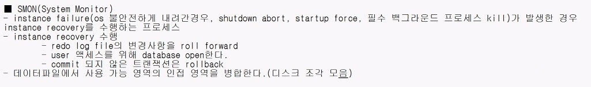

## 261013tue
### [Log Switch](https://docs.oracle.com/en/database/oracle/oracle-database/19/cncpt/physical-storage-structures.html#GUID-26BC209A-999D-4606-84F4-D408A9809232:~:text=%EC%9E%AC%EC%8B%A4%ED%96%89%20%EB%A1%9C%EA%B7%B8%20%EA%B0%9C%EC%9A%94-,%EC%98%A8%EB%9D%BC%EC%9D%B8%20%EC%9E%AC%EC%8B%A4%ED%96%89%20%EB%A1%9C%EA%B7%B8%20%EC%8A%A4%EC%9C%84%EC%B9%98,-Oracle%20Database%EB%8A%94) <a id="log-switch"></a>
- [Control File](261007.md#control-file) 내용 上 ' STATUS ' == ' CURRENT ' Redo Log File 가득찰시, [LGWR](#lgwr) 프로세스가 다른 그룹에 기록을 시작하는 시점
- ' Log Switch ' 발생시, [Partial Check Point](#partial-check-point) 발생
  - ```SQL
    ALTER SYSTEM SWITCH LOGFILE;
    ```
    > 수동으로, ' Log Switch ' 발생 예제 코드
---
</br></br></br>


### Check Point Event <a id="check-point-event"></a>
- [Database Buffer Cache](SGA.md#database-buffer-cache) 內 수정된 버퍼를 ( Dirty Buffer == Dirty Block ) Data 파일에 Write 시점
  - Data 파일과 Redo 로그의, 동기화 상태를 맞추는 작업이자, 그 결과로 기록된 정렬된 시점(SCN)
- DB 비정상 종료시, 디스크에 Write 작업된 Check Point 시점 이후부터만 복구하여 Instance Recovery 시간 단축
- Check Point 시각, SCN(System Change Number), Recovery 시작할 Redo Log File 위치 정보 소유
- ```SQL
  SHOW PARAMETER log_checkpoints_to_alert;
  ```
  > ' log_checkpoints_to_alert ' == ' True ' == ' Check Point ' 발생시, [Alert Log File](261007.md#alert-log-file) 기록

</br></br></br>
#### Full Check Point
- ```SQL
  ALTER SYSTEM CHECKPOINT; /* 수동으로, Full Check Point 발생 */
  --ALTER DATABASE BEGIN BACKUP; /* 차후, 백업 진도에서 배울 예정 */
  ```
- DB 정상 종료시, ' Full Check Point ' 흐름
  - ```
    1. DB 종료 시도 ( shutdown )
    2. CKPT 프로세스가 DBWR 프로세스에게 Signal
    3. DBWR 작동 前 LGWR 작동
    4. DBWR 작동 ( Dirty Buffer Write )
    5. CKPT Data File 헤더에 Check Point 정보 기록
    6. Control 파일에도 정보 기록
    7. DB 정상 Down
    ```
</br></br></br>
#### Partial Check Point <a id="partial-check-point"></a>
- Table Space 內 변경된 블록들을 Write 작업
  - [Control File](261007.md#control-file) 내용 上 ' STATUS ' == ' CURRENT ' 그룹만 Write
- ```SQL
  ALTER TABLESPACE users OFFLINE NORMAL;
  ALTER TABLESPACE users BEGIN BACKUP;
  ALTER users READ ONLY;
  DROP TABLE HR.EMP PURGE;
  TRUNCATE TABLE HR.EMP;
  PARALLEL QUERY ( SELECT /*+ FULL(e) PARALLEL(e, 2) */ * FROM HR.EMP e )
  ```
  > ' Partial Check Point ' 발생 시점 예제 코드 ( 차후, 백업 진도에서 배울 예정 )

</br></br></br>
#### Incremental Check Point
- Instance Recovery 시간을 제어하는 방법
  - ```SQL
    ALTER SYSTEM SET fast_start_mttr_target = 600 SCOPE = BOTH;
    ```
    - Instance Recovery 시간이 600초 이상 소요되지 않게, Check Point 발생
      - 가장 오래된 Dirty 버퍼부터 Write
      - 너무 적게 설정시, 잦은 Write 작업으로 비권장 ( Write 작업 後 Access 필요시, 다시 메모리로 올려야 하는 부담 )
---
</br></br></br>


### Background Process
- Oracle DB Instance 일부로서, DB 운영 및 여러 사용자 성능을 향상시키는데 필요한 유지 관리 작업 수행
- Instance 시작시, 자동 생성
```SQL
SELECT * FROM v$process WHERE pname IS NOT NULL;
```
> 현재 동작중인 Background Process 조회 예제
---
</br></br></br>
#### LGWR ( Log Writer ) <a id="lgwr"></a>
- [Redo Log Buffer](SGA.md#redo-log-buffer) 內 Redo Entry, [Redo Log File](RedoLogFile.md#redo-log-file) 기록하는 Background Process
  - [Control File](261007.md#control-file) 내용 上 ' STATUS ' == CURRENT ' 그룹의 멤버들에 동시 기록 ( 파일이 가득찰 경우, [Log Switch](#log-switch) 발생 )
- |작동 시점|
  ---|
  ' Redo Log Buffer ' 1/3 찼을 경우|
  COMMIT, ROLLBACK 수행시|
  1MB 이상의 변경 사항이 Redo Log 버퍼에 기록되는 경우|
  3초마다|
  DBRW Background Process 작동 前|
---
</br></br></br>
#### DBWR ( Database Writer ) <a id="dbwr"></a>
- [Database Buffer Cache](SGA.md#database-buffer-cache) 內 Dirty Buffer ( 수정된 Buffer ), Data File 기록하는 Background Process
- |작동 시점|
  ---|
  Free Buffer 찾지 못한 경우|
  Check Point Event 발생 時 CKPT 프로세스의 신호를 받고|
---
</br></br></br>


### CKPT ( Checkpoint Process )
- Check Point Event 발생시, ' [DBWR](#dbwr) ' 프로세스에게 알림
- Check Point 정보를 Data File, [Control File](261007.md#control-file) 갱신 작업
---
</br></br></br>


### SMON ( System Monitor )
<!---->
- shutdown abort, startup force , 필수 Background Process Kill 및 Instance 불안전 종료시 Instance Recovery 수행하는 Process
  - Redo Log File 변경 사항을, ROLL FORWARD ( 차후, 백업 진도에서 배울 예정 )
  - COMMIT 안된 트랜잭션은, ROLLBACK 처리
  - User Access 위해 DB Open
- Data File 中 사용 가능 영역의, 인접 영역을 병합 ( 디스크 조각 모음 개념 )
- Temporary Segment 할당하여, 재사용 가능하게
---
</br></br></br>


### PMON ( Process Monitor ) <a id="pmon"></a>
- User Process 실패시, 수행중이던 Transaction ROLLBACK
  - 해당 Data Buffer Cache Block 정리
    - LOCK, RESOURCE 해지
- 리스너에게 DB 정보를 등록 ( 11g Version 까지 )
---
</br></br></br>


### LREG(Listener Registration Process)
- 리스너에게 DB 정보를 등록 ( 12c Version 부터 )
---
