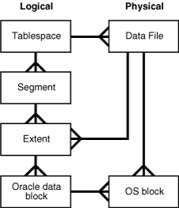

## 261015thu
### Logical And Physical Storage


- 오라클은, 데이터를 논리적 ' Tablespace ' 저장 ( 물리적 Data Files )
</br></br></br>
#### Tablespace
- 하나 이상의 Data 파일로 구성 ( OS 종속 )
- Segment 저장하는, 논리적 저장소
- 보편적으로, 업무별로 분리해서 사용
- ```SQL
  SELECT * FROM DBA_TABLESPACES;
  ```
  > DB 內 생성되어 있는 Tablespace 조회 예제 코드
  - ' SYSTEM ', ' SYSAUX ', ' UNDO* ' Tablespace == 필수
    - ' SYSTEM ' == Data Dictionary 테이블들이 저장되어야 하기에, DB 생성시에 생성 ( System UNDO (Dictionary Table 변경 작업시, System 이전값) 포함 )
    - ' SYSAUX ' == ' SYSTEM ' Tablespace 보조 역할로, AWR 성능 진단과 관련된 Table 저장소 ( 10g Version 신생 )
  - ' CONTENTS ' == ' PERMANENT ' == 영구히 저장이 필요한 Data Tablespace
  - ' CONTENTS ' == ' TEMPORARY ' == PGA 內 [SQL Work Area](261012.md#sql-work-area) 공간 부족시 사용하는 Disk 공간
    - Temp Segment 생성은 Server Process, 해제는 SMON Background Process
  - ' ALLOCATION_TYPE ' == ' SYSTEM ' == Oracle 시스템이, ' INITIAL_EXTENT ' 크기 결정
- ```SQL
  --CREATE TABLESPACE insadata /* Tablespace 생성시, 필수 구문 */
  --DATAFILE '/u01/app/oracle/oradata/ORA19C/insa_tbs01.dbf' SIZE 5M /* Tablespace 생성시, 필수 구문 */
  --EXTENT MANAGEMENT LOCAL AUTOLOCATE; /* 미입력시, ' EXTENT MANAGEMENT LOCAL AUTOLOCATE ' Default 적용 */


  CREATE TABLESPACE insadata
  DATAFILE '/u01/app/oracle/oradata/ORA19C/insa_tbs01.dbf' SIZE 5M AUTOEXTEND ON
  EXTENT MANAGEMENT LOCAL UNIFORM; /* Extent 크기 == 1M */
  ```
  > Tablespace 생성 예제 코드
- ```SQL
  SELECT * FROM dba_data_files;


  --ALTER DATABASE DATAFILE '/u01/app/oracle/oradata/ORA19C/insa_tbs01.dbf' AUTOEXTEND OFF; /* ' AUTOEXTENSIBLE ' == ' NO ' == Auto 확장 기능 Off */
  --ALTER DATABASE DATAFILE '/u01/app/oracle/oradata/ORA19C/insa_tbs01.dbf' AUTOEXTEND ON; /* ' AUTOEXTENSIBLE ' == ' YES ' == Auto 확장 기능 On */
  --ALTER DATABASE DATAFILE '/u01/app/oracle/oradata/ORA19C/insa_tbs01.dbf' AUTOEXTEND ON NEXT 1M MAXSIZE 10M; /* Auto 확장 時 1M 크기로, 최대 10M 크기까지 확장 */
  --ALTER DATABASE DATAFILE '/u01/app/oracle/oradata/ORA19C/insa_tbs01.dbf' AUTOEXTEND ON NEXT 1M MAXSIZE UNLIMITED; /* Auto 확장 時 1M 크기로 무한개수까지 확장 */


  --ALTER DATABASE DATAFILE '/u01/app/oracle/oradata/ORA19C/insa_tbs01.dbf' RESIZE 10M; /* 운영중, DATAFILE 크기 수동 설정 가능 */


  ALTER TABLESPACE insadata ADD DATAFILE '/u01/app/oracle/oradata/ORA19C/insa_tbs02.dbf' 10M; /* Tablespace 內 Data File 추가로 구성 */
  ```
  - ' AUTOEXTENSIBLE ' == 자동 확장 기능 ( ' MAXBYTES ' )
  - ' BYTES ' == Data File 크기
- ```SQL
  --DROP TABLESPACE insadata; /* Segment 존재로, 비어있지 않을시 ERR */
  --DROP TABLESPACE isnadata INCLUDING CONTENTS; /* OS 內 실제 파일은 직접 삭제 필요 */
  DROP TABLESPACE isnadata INCLUDING CONTENTS AND DATAFILES; /* ' AND DATAFILES ' == OS 內 실제 파일까지 삭제 */
  ```
</br></br></br>
##### READ WRITE, READ ONLY Mode <a id="read-only-mode-tablespace"></a>
- 미지정시, ' READ WRITE ' Default
- Meta 데이터가 저장되는 ' SYSTEM ' Tablespace == ' READ WRITE ' 모드 영원히 고정 ( ' READ ONLY ' 모드로 변경 불가 )
  - SYSTEM 파일은, 읽기 전용이 아니므로, Disk 수정 가능
- DB 전체가 아닌, 지정한 테이블스페이스만 ' READ ONLY ' 모드로 변경
- READ ONLY 모드에서는, DML 불허
- |READ ONLY 모드 上|불가 여부|
  ---|---|
  CREATE TABLE|불가|
  ADD COLUMN|가|
  ALTER TABLE MODIFY|가|
  TRUNCATE TABLE|불가|
  DROP TABLE|가|
  DROP COLUMN|불가|
- ```SQL
  ALTER TABLESPACE insadata READ WRITE;
  ALTER TABLESPACE insadata READ ONLY;


  SELECT d.file_id, d.tablespace_name, d.file_name, v.checkpoint_change#, v.enabled, d.online_status
  FROM v$datafile v, dba_data_files d
  WHERE v.file# = d.file_id;
  ```
  > 모드 변경시, [Partial Check Point](261013.md#partial-check-point) 발생 ( ' ENABLED ' )
</br></br></br>
- ```SQL
  ALTER TABLE INSA.EMP MODIFY last_name VARCHAR2(50);
  ALTER TABLE INSA.EMP ADD dept_name VARCHAR2(30);
  DROP TABLE INSA.EMP PURGE;


  --
  --ALTER TABLE INSA.EMP DROP COLUMN dept_name; /* DROP 불가 ERR */
  --TRUNCATE TABLE INSA.EMP; /* TRUNCATE 불가 ERR */
  ```
  - ' SYSTEM ' 테이블스페이스는, 항상 ' READ WRITE ' 모드이므로, Dictionary 수정 작업은 가능 ( ALTER Column MODIFY 수정, ALTER Column ADD 추가, DROP TABLE )
    - 단, DROP TABLE 時 실제 Block 공간 회수 작업은, ' READ WRITE ' 모드로 변경될시에 수행
</br></br></br>
##### OFFLINE MODE <a id="offline-mode-tablespace"></a>
- Tablespace 內 Segment 사용 불가 처리
  - SELECT, DML, DDL 불가
- ' SYSTEM ', 사용중인 ' UNDO ', 사용중인 Temporary 테이블스페이스는 OFFLINE 불가
  - ' SYSAUX ' 테이블스페이스는 OFFLINE 가능
- ```SQL
  ALTER TABLESPACE insadata OFFLINE NORMAL; /* Default */
  ALTER TABLESPACE insadata OFFLINE TEMPORARY;
  ALTER TABLESPACE insadata OFFLINE IMMEDIATE; /* Check Point 미발생 ( Archive Log 모드에서만 사용 가능 ) */
  ```
  > 모드 변경시, [Partial Check Point](261013.md#partial-check-point) 발생 ( ' ENABLED ' )
  - ' OFFLINE TEMPORARY ', ' OFFLINE IMMEDIATE ' == 장애가 발생하여, 복구시 사용 ( 차후, 백업 진도에서 배울 예정 )
</br></br></br>
#### Segment
- Tablespace 內 저장 공간이 필요한 Object ( Datafile 공간 사용 )
  - 오라클이 제공하는 논리적 공간 ( Table, Index, UNDO, lob 등 )
- 여러개의 Data 파일들 사용 가능
- Segment 생성시, 최소 하나의 Extent 할당
- ```SQL
  CREATE TABLE INSA.emp
  TABLESPACE insadata
  AS SELECT * FROM HR.EMPLOYEES;
  ```
- ```SQL
  SELECT * FROM dba_extents WHERE segment_name = 'EMP';
  ```
  > ' HEADER_BLOCK ' 다음 Block == Root Block
  - ' HEADER_FILE ' == ' SELECT * FROM dba_data_files; ' 실행하여 확인시, ' FILE_ID '
</br></br></br>
#### Extent
- 연속된 Oracle 블록들로 구성
- 하나 이상의 Extent, Segment 구성 ( Segment 사용 공간 )
  - Table 생성시 할당
  - Extent 가득차고, Data 입력시 Extend ( 확장 )
    - 입력했던 Data 지워도, 자동으로 확장된 Extent 그대로 유지된다
  - Segment 삭제시나, Truncate 時 Extent 해제
  - 수동으로 확장, 해제 Alter 변경 가능
- 테이블을 생성하면, ' USERS ' Extent Default 생성 ( Extent 개수, 크기는 Tablespace 생성시 결정 )
</br></br></br>
#### Block
- 하나 이상의 OS 블록으로 생성
  - ```SQL
    SELECT MAX(lebsz) FROM v$kccle;
    ```
    > OS Block 크기 조회 예제 코드
- 실제 데이터가 저장되는 곳
- Oracle 최소 I/O 단위
- 2k, 4k, 8k, 16k, 32k 크기 사용 가능 ( Default 8k )
  - ' db_block_size ' Parameter
---
</br></br></br>


### Data File 이관
#### DB 운영중, 특정 Tablespace 이관
1. 이관할 File 조회
   ```SQL
   SELECT NAME FROM v$datafile;
   SELECT NAME FROM v$tempfile;
   ```
   ```SQL
   SELECT 'mv -v ' || NAME || ' /home/oracle/Documents/' AS "Command" FROM v$datafile;
   ```
   |Command|
   ---|
   mv -v /u01/app/oracle/oradata/ORA19C/system01.dbf /home/oracle/Documents/|
   mv -v /u01/app/oracle/oradata/ORA19C/undotbs02.dbf /home/oracle/Documents/|
   mv -v /u01/app/oracle/oradata/ORA19C/sysaux01.dbf /home/oracle/Documents/|
   . . .|
   > SQL Developer 프로그램에서, OS 內 필요한 Command 문구 추출 예제 코드
3. Tablespace [OFFLINE](#offline-mode-tablespace) ' NOMAL '
   - ' SYSTEM ' 등의, OFFLINE 불가한 Tablespace 불가
5. OS 內 물리적 File 이동
   - ```CMD
     mv /home/oracle/Documents/insadata01.dbf /u01/app/oracle/oradata/ORA19C/userdata01.dbf
     ```
6. Data File 경로 정보 수정
   ```SQL
   ALTER TABLESPACE insadata RENAME DATAFILE '/home/oracle/Documents/insadata01.dbf' TO '/u01/app/oracle/oradata/ORA19C/userdata01.dbf';
   ```
7. Tablespace ONLINE
   ```SQL
   ALTER TABLESPACE insadata ONLINE;
   ```
---
</br></br></br>


#### DB 전체 이관
1. DB 정상 종료 ( shutdown immediate; )
2. OS 內 물리적 File 이동
3. ```
   startup mount

   
   SELECT INSTANCE_NAME, STATUS FROM v$instance;
   ```
   > ' STATUS ' == ' MOUNTED ' == mount 시점까지 DB Open
4. Data File 경로 정보 수정
   ```SQL
   ALTER DATABASE RENAME FILE '/home/oracle/Documents/system01.dbf' TO '/u01/app/oracle/oradata/ORA19C/system01.dbf';
   ALTER DATABASE RENAME FILE '/home/oracle/Documents/insadata01.dbf' TO '/u01/app/oracle/oradata/ORA19C/userdata01.dbf';
   ALTER DATABASE RENAME FILE '/home/oracle/Documents/insadata02.dbf' TO '/u01/app/oracle/oradata/ORA19C/userdata02.dbf';
   ```
5. DB Open ( ALTER DATABASE OPEN; )
---
