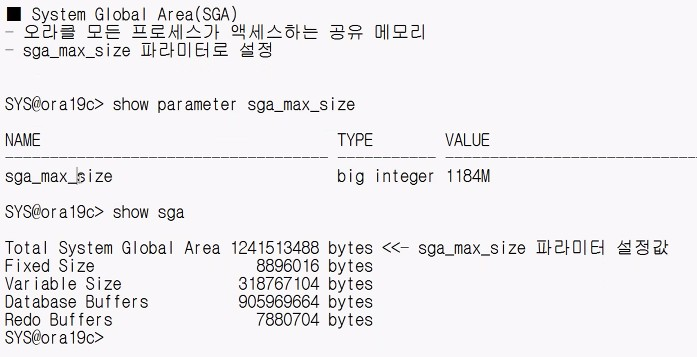
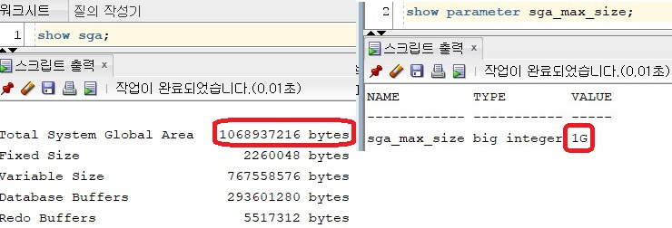
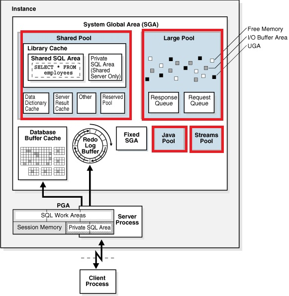
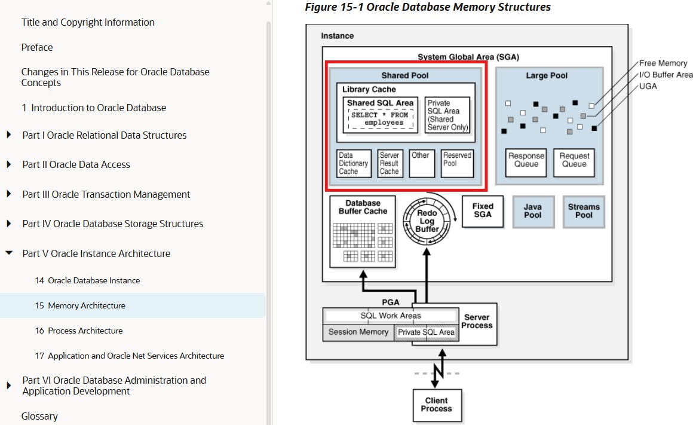
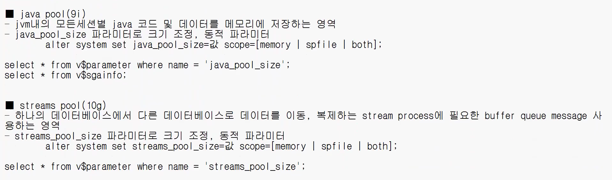
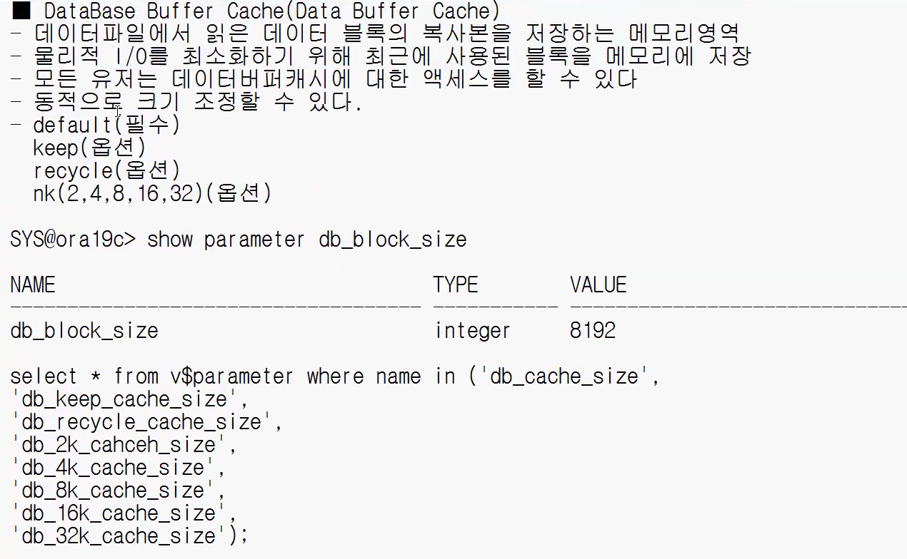
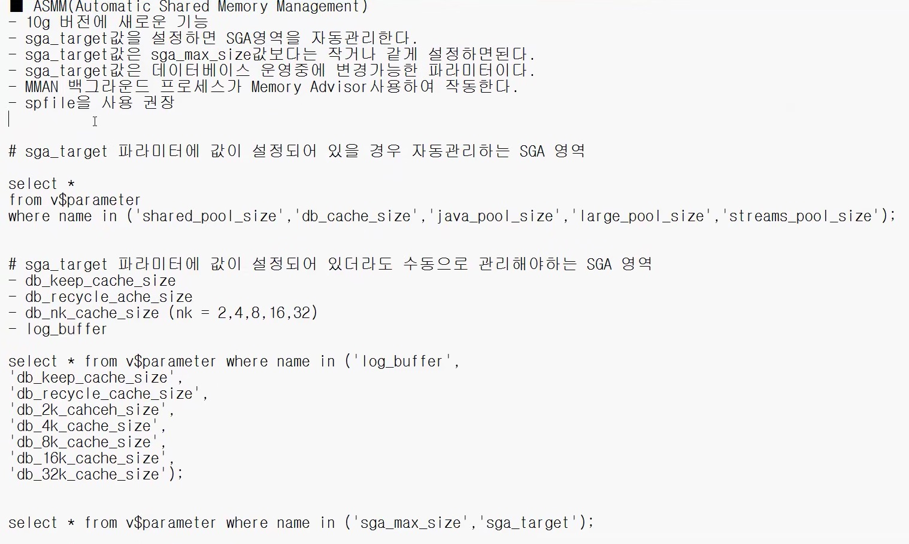

### SGA(System Global Area) <a id="sga"></a>


- Total System Global Area
  - 
- Fixed Size
  - Background 프로세스가 엑세스하는, DB 및 Instance 상태에 대한 일반적인 정보 ( 오라클이 내부적으로 사용하는 메모리 영역으로서, 오라클사에서 내부를 공개하지 않았다고 한다 )
- Variable Size = Shared Pool + Large Pool + Java Pool + Streams Pool
  - 

    - Shared Pool
      - ' shared_pool_size ' 파라미터로, 동적 크기 조정 가능 ( ISSYS_MODIFIABLE == IMMEDIATE (Dynamic Parameter) )
        - ```SQL
          SHOW PARAMETER shared_pool_size;
          ```
          > VLAUE == ' 0 ' 의미는, 크기를 오라클이 자동 관리하겠다는 의미
      - 

        - 다양한 유형의 프로그램 데이터를 캐시 해두는 영역
          - Data Dicionary Cache (Row Cache) == Semantic Check ( 의미 분석 체크 ) 할때마다, 디스크 I/O 발생 부담으로, ' Data Dictionary ' 정보를 메모리에 Row 단위로 올려놓은 메모리 공간 <a id="data-dictionary-cache"></a>
            - ```SQL
              SELECT *
              FROM dba_segments
              WHERE tablespace_name = 'SYSTEM';
              ```
              > 내부적으로 ' HEADER_BLOCK ' 다음이, Root Block
          - Library Cache ( 가칭 ) == 클라이언트가 수행한 SQL, PL / SQL 대한 정보, 실행 계획을 갖고있는 메모리 <a id="library-cache"></a>
            - ```SQL
              SELECT SQL_ID, SQL_TEXT, PARSE_CALLS, LOADS, EXECUTIONS, PLAN_HASH_VALUE, HASH_VALUE
              FROM v$sql
              ```
              > Shared Pool 內 Library Cache 內 ' SQL 문장 '
              - ' PARSE_CALLS ' == Library Cache 요청한 횟수 ( ' EXCUTIONS ' 같이 증가 )
              - ' EXCUTIONS ' == 실행 횟수 ( ' PARSE_CALLS ' 같이 증가 )
              - ' LOADS ' == Library Cache 요청 했으나, 없을시 HARD PARSING 발생하며 증가하는 횟수 ( 실행 계획 생성 )
              - ' PLAN_HASH_VALUE ' == 실행 계획 고유값 ( 이가 같다는 뜻은, 실행 계획이 같다는 의미 ) <a id="plan_hash_value"></a>
    - Large Pool
      - ' large_pool_size ' 파라미터로, 동적 크기 조정 가능 ( ISSYS_MODIFIABLE == IMMEDIATE (Dynamic Parameter) )
        - ```SQL
          SELECT *
          FROM v$parameter
          WHERE NAME = 'large_pool_size';
          ```
          > VLAUE == ' 0 ' 의미는, 크기를 오라클이 자동 관리하겠다는 의미
      - Oracle Shared Server 환경시 UGA(User Global Area) 생성 ( 차후 네트워크 진도에서 배울 예정 )
      - RMAN 이용하여 백업, 복구 작업 수행시 사용하는 Memory 영역
      - 병렬 쿼리(Parallel Query) 작업 수행시 사용 ( 차후 튜닝 진도에서 배울 예정 )
    - 
    <!--StreamsPool?  -->
</br></br></br>
- Database Buffer Cache ( Data Buffer Cache ) <a id="database-buffer-cache"></a>
  -  Semantic 체크시 ( 의미 분석 체크 ) 사용하는, ' Data Files ' 內 ' Data Dictionary ' Data Block 복사본을 저장하는 메모리 영역 ( 디스크와의 물리적 I/O 부담 저감 )
  -  모든 유저가, Sever 프로세스를 통해 Access 가능
  -  동적 크기 조정 가능
  - 
</br></br></br>
- Redo Buffers
  - Redo Log Buffer
    - DB Data Block 모든 변경 사항을 기록한, 복구 목적으로 구성된 메모리
    - Redo Entry ( 변경 사항 )
      - 변경 사항을 재구성하거나, 재실행 정보 포함
      - DML(INSERT, UPDATE, DELETE, MERGE), DDL(CREATE, ALTER, DROP, ' SELECT * FOR UPDATE ') 사용시 자동 생성
    - ' log_buffer ' Parameter (Static Parameter) 이용하여, 크기 조정 가능
---
</br></br></br>


### ASMM(Automatic Shared Memory Management) == 10g Version 등장 기능
- ' sga_target ' 파라미터에 값을 설정시, ' MMAN ' Background 프로세스가 Memory Advisor 통해서, ' shared_pool_size ', ' db_cache_size ', ' java_pool_size ', ' large_pool_size ', 'streams_pool_size ' [SGA](SGA.md#sga) 영역을 자동 관리
  - ' sga_target ' 값은, ' sga_max_size ' Parameter 값보다 작거나 같게 설정하면 된다
  - [초기 파라미터 파일](InitializationParameterFileAndParameter.md#initial-parameter-file"), ' Server Parameter File ( spfile ) ' 권장
  - ' db_kkeep_cache_size ', ' db_recycle_cache_size ', ' db_2k_cache_size ', ' db_4k_cache_size ', ' db_8k_cache_size ', ' db_16k_cache_size ', ' db_32k_cache_size ', ' log_buffer ' SGA 영역은 수동으로 관리 필수
<!-- 
> https://youtu.be/sAl4bcItBAs?list=PLT1Dy2YqI-1U&t=5685 -->

---
</br></br></br>


### AMM(Automatic Memory Management)
- 작업 로드에 따라 [PGA](261012.md#pga), [SGA](SGA.md#sga) 크기 조정을 자동 수행
  - ' sga_target ', ' pga_aggregate_target '
  - ' memory_target ' 값을 설정해야 한다
  - ' memory_max_target ' == 오라클이 사용할수 있는 최대 메모리
---
