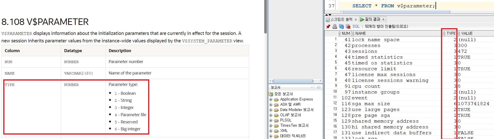

# itwill 97th
## 26.08.19.水 ~ 26.08.28.金 : 01.Python by 신미영 강사님
---
## 26.08.31.月 ~ 26.09.15.火 : 02.SQL
## 26.09.16.水 ~ 26.10.02.金 : 03.PL / SQL
---
## 26.10.06.火 ~ 26.10.26.月 : 04.Administration
### (https://docs.oracle.com/en/database/oracle/oracle-database/19/administration.html)
- Most Popular
  - Database Concepts
  - Database Error Messages : ' ORA-* ' ERR
  - Database Reference
    - [Part III Dynamic Performance Views](https://docs.oracle.com/en/database/oracle/oracle-database/19/refrn/dynamic-performance-views.html)
      - [v$ 계열 中 ' v$parameter '](https://docs.oracle.com/en/database/oracle/oracle-database/19/refrn/V-PARAMETER.html)
        - 
---
## 26.10.27.火 ~ : 05.Backup&Recovery
