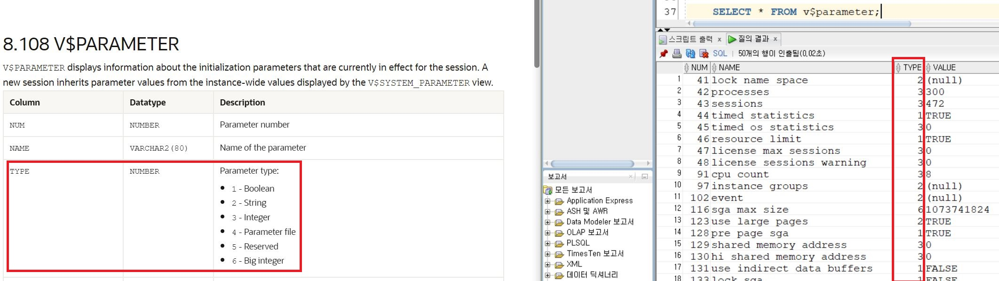

# itwill 97th
### 26.08.19.水 ~ 26.08.28.金 : 01.Python by 신미영 강사님
---
### 26.08.31.月 ~ 26.09.15.火 : [02.SQL](https://youtube.com/playlist?list=PLfUl7mXPIz3A&si=JerKpPjhX5mWUsVW)
### 26.09.16.水 ~ 26.10.02.金 : [03.PL / SQL](https://youtube.com/playlist?list=PLe7zCZQNdpJk&si=dHtydbXyhGQcM9X8)
---
### 26.10.06.火 ~ 26.10.26.月 : [04.Administration](https://youtube.com/playlist?list=PLT1Dy2YqI-1U&si=wnYiMZZQfXUPbJyj)
#### (https://docs.oracle.com/en/database/oracle/oracle-database/19/administration.html)
- Most Popular
  - Database Concepts
  - Database Error Messages : ' ORA-* ' ERR
  - Database Reference
    - [Part III Dynamic Performance Views](https://docs.oracle.com/en/database/oracle/oracle-database/19/refrn/dynamic-performance-views.html)
      - [v$ 계열 中 ' v$parameter '](https://docs.oracle.com/en/database/oracle/oracle-database/19/refrn/V-PARAMETER.html)
        - 
---
### 26.10.27.火 ~ 26.11.17.火 : [05.Backup&Recovery](https://youtube.com/playlist?list=PLR0S9hC832pM&si=fP5l8aFGwFRTBpNc)
#### (https://docs.oracle.com/en/database/oracle/oracle-database/19/rcmrf/deprecated-rman-syntax.html)
---
### 26.11.18.水 ~ : [06.Performance Tuning](https://youtube.com/playlist?list=PLG8nA2_RVbjU&si=hFE3ae3JoY3wZteQ)
---
